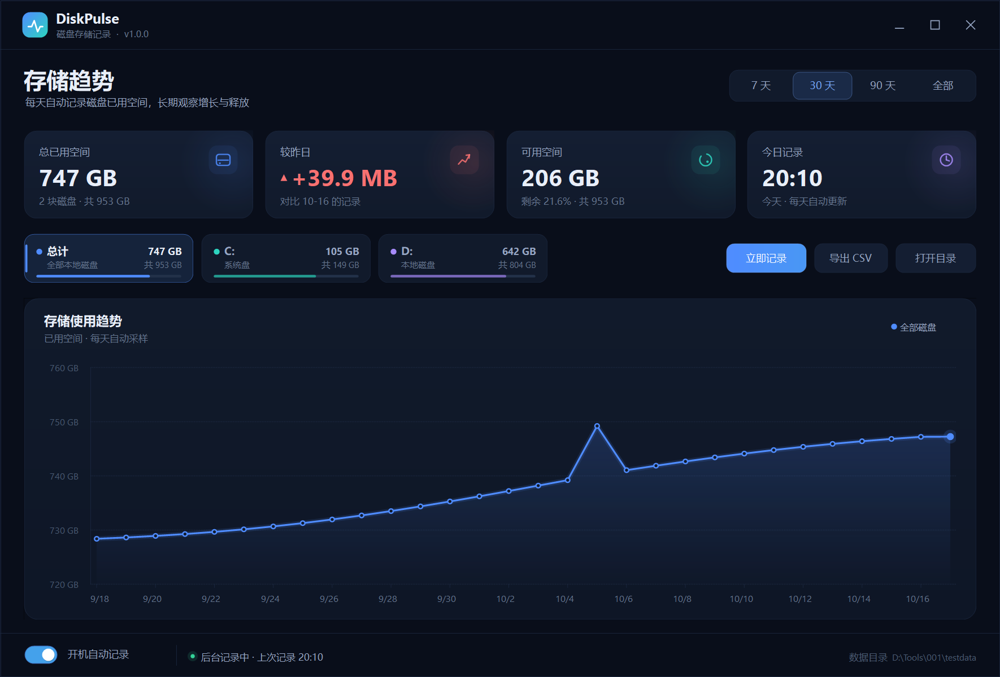

# DiskPulse · 磁盘存储记录

一个轻量的 Windows 桌面工具：每天自动记录本地固定磁盘的已用空间，打开软件即可查看长期变化曲线。



## 快速开始

1. 从 `Releases` 下载 `DiskPulse-win64.zip`，或直接使用本目录构建出的 `DiskPulse.exe`。
2. 把 `DiskPulse.exe` 放到一个固定文件夹（建议不要放在压缩包预览或临时目录中）。
3. 双击 `DiskPulse.exe`。
4. 首次运行时软件会自动：
   - 读取当前所有本地固定磁盘（如 C:、D:）；
   - 在 `%LOCALAPPDATA%\DiskPulse` 建立历史数据；如果此位置不可写，会自动改用 exe 同目录的 `DiskPulseData`；
   - 将自身加入当前用户的登录启动项，以后登录 Windows 时静默启动，不弹窗。
5. 点击窗口右上角关闭按钮会收起到系统托盘，后台继续记录；右键托盘图标可以重新打开或退出。

> **Windows SmartScreen 提示“已保护你的电脑”**  
> 程序未使用商业代码签名证书，所以可能显示“发行者未知”。点击“仍要运行”即可。不要从下载面板或聊天文件卡直接启动，建议先解压到固定目录，再从资源管理器双击 `DiskPulse.exe`。

## 主要功能

- **每日自动记录**：登录后静默启动；软件运行期间约每小时更新当天快照；跨天、开机都会自动补记。
- **变化曲线**：支持 7 天 / 30 天 / 90 天 / 全部；鼠标悬停查看当天各磁盘的已用与可用空间。
- **磁盘筛选**：点击顶部磁盘标签，可查看总计或单独磁盘的曲线。
- **概览卡片**：总已用空间、较昨日变化、可用空间、今日记录时间。
- **手动记录**：点击“立即记录”或按 `F5`。
- **导出 CSV**：点击“导出 CSV”或按 `Ctrl+E`，可用 Excel 打开。
- **导入 CSV**：点击“导入 CSV”或按 `Ctrl+I`，把历史 CSV 合并进当前数据。
- **开机自动记录开关**：界面底部开关，或托盘右键菜单。
- **无需管理员权限**：只写入当前用户目录和 `HKCU` 启动项。
- **完全本地**：不联网、不上传任何数据。

## 数据保存在哪里

默认目录：`%LOCALAPPDATA%\DiskPulse`

如果该目录不可写（例如受限账户、从受限环境启动，或作为便携软件放在没有权限的目录），软件会自动改用可写的位置：优先使用 exe 同目录下的 `DiskPulseData`，仍不可写时使用临时目录。一旦 `DiskPulseData\history.json` 已存在，后续会继续使用该便携目录，避免历史数据分散。界面右下角始终显示实际使用的目录。

| 文件 | 内容 |
| --- | --- |
| `history.json` | 每天一条的磁盘快照历史 |
| `settings.json` | 界面与自启动设置 |
| `logs\app-*.log` | 运行日志（保留 14 天） |

界面右下角会显示当前数据目录；点击“打开目录”即可在资源管理器中查看。

### 备份与卸载

- **备份**：退出软件后复制整个数据目录即可。
- **卸载**：关闭“开机自动记录” → 托盘右键“退出 DiskPulse” → 删除 `DiskPulse.exe` 和数据目录（默认 `%LOCALAPPDATA%\DiskPulse`，也可能是 exe 同目录的 `DiskPulseData`）。

## 开机自动记录说明

首次运行会写入当前用户的启动项：

```
HKCU\Software\Microsoft\Windows\CurrentVersion\Run
值名称：DiskPulse
值数据："完整路径\DiskPulse.exe" --silent
```

- 登录 Windows 后以 `--silent` 启动：不显示主窗口、不弹窗，只在托盘显示图标。
- 如果安全软件或其他受限环境拦截启动项，底部会出现红色提示。此时从资源管理器双击一次 `DiskPulse.exe`，软件会重试写入启动项。
- 移动 `DiskPulse.exe` 后，在新位置运行一次会自动更新启动项路径。

### 提示“无法修改开机启动项”或“权限不够”怎么办

如果软件是从受限的应用面板、沙箱、远程工具等环境启动的，Windows 会拒绝它写入启动项；这不是磁盘权限问题。最省事的解决方式：

1. 关闭 DiskPulse。
2. 打开 `DiskPulse.exe` 所在文件夹（例如 `D:\Tools\001`）。
3. 双击 `启用开机自启.cmd`，看到 `[OK]` 即表示启动项已写入。
4. 以后正常双击 `DiskPulse.exe` 即可；下次登录 Windows 会自动静默记录。

需要取消时，双击 `关闭开机自启.cmd`。这两个脚本只写当前用户的 `HKCU` 启动项，不需要管理员权限，也不会修改其他设置。

## 命令行参数

| 参数 | 作用 |
| --- | --- |
| `DiskPulse.exe` | 打开主界面 |
| `DiskPulse.exe --silent` | 静默后台运行（开机启动使用） |
| `DiskPulse.exe --record` | 记录一次后退出 |
| `DiskPulse.exe --export 文件.csv` | 导出全部历史后退出 |
| `DiskPulse.exe --import 文件.csv` | 从 CSV 导入历史后退出（需先退出已运行的 DiskPulse） |
| `--no-autostart` | 本次不修改开机启动项（调试用） |

导入的 CSV 支持软件自己导出的格式（表头为 `日期,磁盘,卷标,总容量(GB),已用(GB),可用(GB),使用率(%)`），也接受没有表头、按同样顺序排列的数据。相同日期会合并，同一日期同一磁盘以 CSV 中最后一行覆盖。

## 从源码构建

要求：Windows 10 / 11，系统自带 .NET Framework 4.8；无需安装 Visual Studio。

在项目目录运行：

```powershell
powershell -ExecutionPolicy Bypass -File .\Build.ps1
```

构建会生成：

- `DiskPulse.exe`：可直接运行的软件；
- `使用说明.md`：本说明；
- `DiskPulse-win64.zip`：分发包。

源码位于 `src`，图标资源位于 `assets`，图标生成脚本为 `tools\MakeIcon.ps1`。

## 备注

- 只统计 `DriveType=Fixed` 的本地固定磁盘，不包含 U 盘、光驱和网络映射盘。
- 每天保留一个数据点；软件运行期间会用当天最新值更新该点。
- 如果某天电脑没有开机或软件没有运行，该天会没有记录，曲线会跨过空白日期连接相邻记录。
- 曲线展示的是“已用空间”；剩余空间请查看顶部“可用空间”卡片。
- 系统需要 .NET Framework 4.8（Windows 10 1903+ 和 Windows 11 默认包含）。

## License

MIT License，详见 [LICENSE](LICENSE)。
